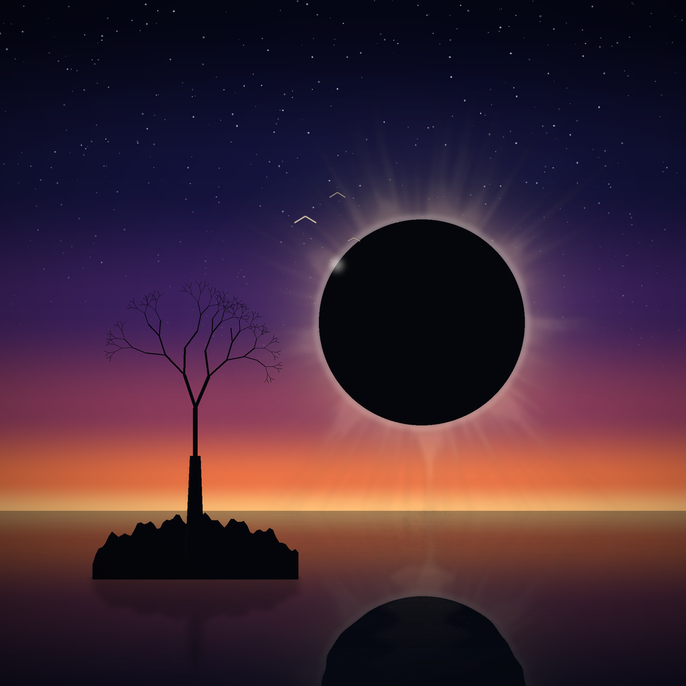

# Eclipse over a glass sea

An entry for [make.fun coolest-art-01](https://make.fun/bounty/coolest-art-01).



A total eclipse behind a bare tree on a rock, reflected in a still sea. The
picture is 1024x1024 PNG, 345 815 bytes, drawn entirely from arithmetic by
`tools/generate.py`: a five-stop sky gradient, a corona built from 2 200 thin
angular rays plus a stacked bloom, water mirrored row by row through a sine
ripple, a jagged rock silhouette and a recursive branch routine. One seeded
random generator drives every choice, so the drawing is reproducible byte for
byte.

## Run it

```sh
python3 main.py        # writes entry.png into $MAKEFUN_OUTPUT_DIR (default /output)
```

`main.py` validates the committed PNG (signature, IHDR geometry, every chunk's
CRC, a final IEND) and copies its bytes unchanged, so two runs write identical
bytes. It refuses anything over 1 MiB or over 1024 px a side.

## Regenerate the picture

```sh
python3 tools/generate.py art.png
```

Needs Pillow and NumPy. The result is identical on every run on the same
versions.

## Licence

MIT.
